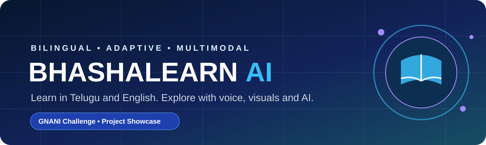
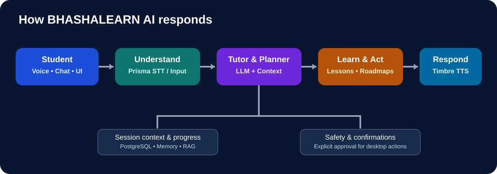
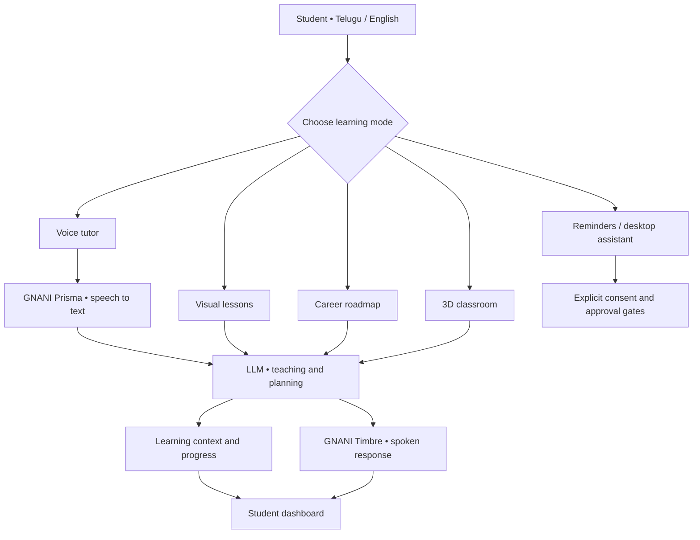
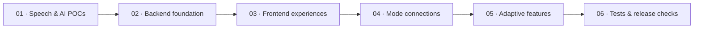

# BHASHALEARN AI
### Your bilingual AI learning companion — తెలుగు + English

**Speak naturally · See concepts come alive · Learn at your pace**

**[Explore features](#-the-experience) · [See the architecture](#-how-it-works) · [Development journey](#-how-we-built-it) · [Demo guide](#-demo-walkthrough) · [Technical details](#-technology-stack)**

---

## ✨ The idea

Great learning should not depend on speaking only one language or reading only one kind of explanation. **BHASHALEARN AI** explores a more natural classroom: ask a question in **Telugu, English, or a mix**, get an adaptive explanation, interact with a visual lesson, and return to your learning journey.

Built for the **GNANI Challenge**, the project combines conversational AI, speech technologies, interactive lessons, student progress, career guidance, and a 3D teacher experience.

> **Project snapshot:** The repository includes an initial proof-of-concept baseline and separately developed feature implementations. Automated tests cover significant functionality; some live-provider, Windows, PostgreSQL, and end-to-end release checks are still pending. See [Implementation & verification](#-implementation--verification) for the precise status.

## 🎯 The experience

<table>
<tr>
<td width="50%" valign="top">

### 🎙️ 01 · Speak & learn
**Bilingual voice tutoring**

- Telugu / English / mixed-language questions
- GNANI Prisma speech-to-text
- AI-generated teaching responses
- GNANI Timbre spoken replies
- Transcript review and session context

</td>
<td width="50%" valign="top">

### 🧠 02 · Learn visually
**Interactive visual studio**

- React Flow concept maps and connected steps
- 3D React Three Fiber scenes with 2D fallback
- Generated lesson validation and quizzes
- Saved progress, replay, and resume
- Voice-to-lesson handoff

</td>
</tr>
<tr>
<td valign="top">

### 🧭 03 · Find your path
**Future Seeker career guidance**

- Consent-based PDF/DOCX resume analysis
- Skill-gap insights and explainable readiness
- Interactive prerequisite roadmaps
- Weekly plans, milestones, and assessments
- Career-aware bilingual AI mentoring

</td>
<td valign="top">

### 👩‍🏫 04 · Meet your AI teacher
**Immersive classroom**

- VRM-based 3D avatar preview
- Facial expressions and blinking
- Audio-responsive mouth cues
- Interactive classroom controls
- Bilingual voice integration pathways

</td>
</tr>
<tr>
<td valign="top">

### ⏰ 05 · Stay on track
**Smart reminders**

- Assignment and deadline tracking
- Browser or opt-in phone delivery
- Retry-safe scheduled jobs
- Reminder history and preferences
- Explicit consent and telephony safeguards

</td>
<td valign="top">

### 🖥️ 06 · Act with your voice
**Permission-first desktop assistance**

- Voice-to-action planning
- Website discovery and opening
- Transcript and action preview
- Browser confirmation **and** Windows approval
- Denial, cancellation, and emergency-stop safeguards

</td>
</tr>
</table>

## 🧩 How it works

**Design principle:** conversation, visuals, progress, and action are separate capabilities connected by explicit session context and user controls. External services and desktop actions must fail safely.

## 🛠️ Technology stack

| Layer | Technologies |
|---|---|
| Interface | React, TypeScript, Vite |
| API | Python, FastAPI, Pydantic |
| Data & migrations | PostgreSQL, SQLAlchemy, Alembic |
| Speech recognition | GNANI Prisma |
| Speech synthesis | GNANI Timbre |
| AI tutoring and planning | Gemini / configurable LLM adapters |
| Interactive diagrams | React Flow |
| 3D classroom | Three.js, React Three Fiber, `@pixiv/three-vrm` |
| Real-time voice / calling prototype | LiveKit Agents, guarded SIP dispatch |
| Testing | pytest, frontend unit tests, Playwright, GitHub Actions |

## 🧪 How we built it

The engineering journey follows a **six-stage build-and-verify pipeline**:

**01 — Prove the AI foundation.** Prototype GNANI Prisma STT, Timbre TTS, and bilingual tutoring before depending on them in the classroom.

**02 — Design the application core.** Define FastAPI contracts, student authentication, session context, persistence, and migration patterns.

**03 — Make learning interactive.** Build dashboard, voice studio, visual smartboard, career roadmap, and avatar-based classroom interfaces.

**04 — Connect the experience.** Pass lesson topics between voice and visual modes, connect teaching responses to student context, and preserve explicit approval boundaries for actions.

**05 — Add adaptive capabilities.** Develop skill assessments, progress tracking, resume review, saved lesson state, reminder scheduling, and conversational follow-up.

**06 — Test what actually works.** Run unit tests, migration checks, mocked browser journeys, builds, and platform contracts. Record live-provider and device acceptance separately rather than treating mocks as real-world proof.

## 🎬 Demo walkthrough

A short, clear demo is more persuasive than a long feature list. Suggested **90–120 second** recording:

| Time | Show on screen | Narration |
|---|---|---|
| 0–15s | Project landing page and dashboard | “Meet BHASHALEARN AI, a bilingual learning companion.” |
| 15–35s | Ask a question in Telugu or English | “Students can learn through natural voice conversations.” |
| 35–55s | Visual lesson / concept graph | “Concepts become interactive diagrams and guided steps.” |
| 55–75s | Career skill roadmap | “The roadmap adapts to skills, goals, and progress.” |
| 75–95s | 3D teacher preview | “An expressive avatar makes the classroom more engaging.” |
| 95–115s | Reminder / permission-based assistant | “Learning continues with planning and user-controlled actions.” |

**Demo safety:** Show only functionality that works in your environment. If live voice, desktop execution, or calls are unavailable, label that segment as a *prototype preview* or omit it. Avoid exposing API keys, personal resumes, phone numbers, or private student data.

### 📸 Screenshots and recording

Real screenshots should come from the running application, not from generated concept art. Suggested shots:

1. **Student dashboard** — logged-in landing view.
2. **Voice classroom** — transcript and bilingual response.
3. **Visual studio** — React Flow lesson and 3D/2D scene.
4. **Future Seeker** — skill graph and progress.
5. **3D teacher** — visible VRM avatar.
6. **Reminders / desktop approvals** — consent and review UI.

Once captured, place images in `docs/screenshots/` and replace this section with a screenshot gallery. **No screenshots are claimed or fabricated in this README.**

## 🧬 Implementation & verification

This is an active engineering project. The following links show the implementation tracks and their documented test boundaries:

| Capability | Implementation / verification |
|---|---|
| Voice-to-desktop assistant | [Feature 1 draft PR #2](https://github.com/tejaswini143-byte/BHASHALEARN-AI/pull/2) — targeted tests passed; live Windows actions require acceptance |
| Deadline reminders and calling | [Feature 2 draft PR #6](https://github.com/tejaswini143-byte/BHASHALEARN-AI/pull/6) — scheduler and mocked SIP tests passed; real calling and production integration pending |
| Future Seeker | [Feature 3 draft PR #3](https://github.com/tejaswini143-byte/BHASHALEARN-AI/pull/3) — [hosted CI](https://github.com/tejaswini143-byte/BHASHALEARN-AI/actions/runs/43678120405) passed; live provider acceptance pending |
| Interactive visual lessons | [Feature 4 draft PR #7](https://github.com/tejaswini143-byte/BHASHALEARN-AI/pull/7) — 9 mocked browser scenarios passed; live Gemini/PostgreSQL checks pending |
| 3D teacher | Avatar and classroom work developed in dedicated feature worktrees; live browser and bilingual voice acceptance pending |

**Important:** The default `main` branch is an early POC baseline. Feature work is available on the linked branches/PRs; this README describes the project vision and verified progress, not a claim that every feature is already merged into `main`.

## 🚀 Getting started

This repository is organized by development stage. For the initial proof of concept, begin with:

- [Prisma STT POC](pocs/poc01_prisma_stt/README.md)
- [Phase 1 tracker](docs/PHASE1_TRACKER.md)
- Feature-specific setup and test instructions in the linked draft PRs

For the larger application, check out the relevant feature branch and follow its own setup instructions. You will generally need Python, Node.js, the appropriate database, and provider credentials for live tests.

**Never commit `.env` files, credentials, private voice recordings, or student documents.** Use environment templates and approved test accounts.

## 🌱 What's next

- End-to-end validation against live GNANI / Gemini services
- Unified student login, classroom routing, and progress continuity
- PostgreSQL-backed production acceptance
- Real browser and Windows testing with explicit operator approval
- Accessible, responsive polish and a complete demo recording

---

### Learning should speak your language.

**BHASHALEARN AI · Built for the GNANI Challenge**

[Back to top ↑](#bhashalearn-ai)

